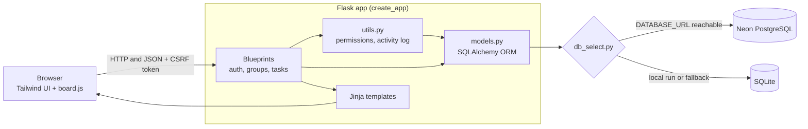
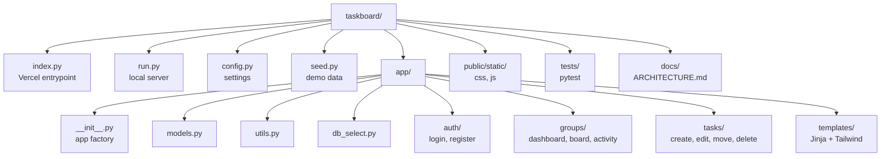
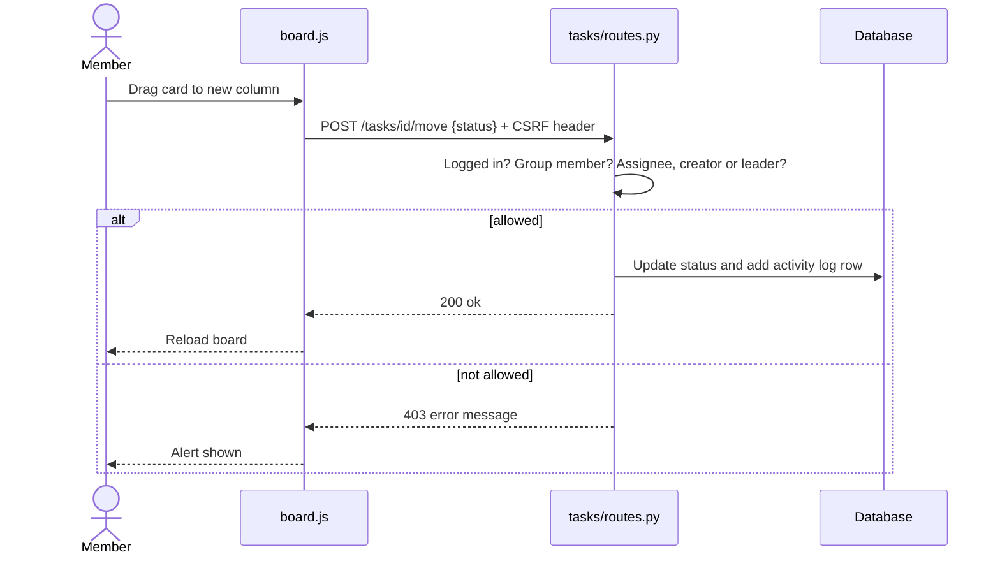
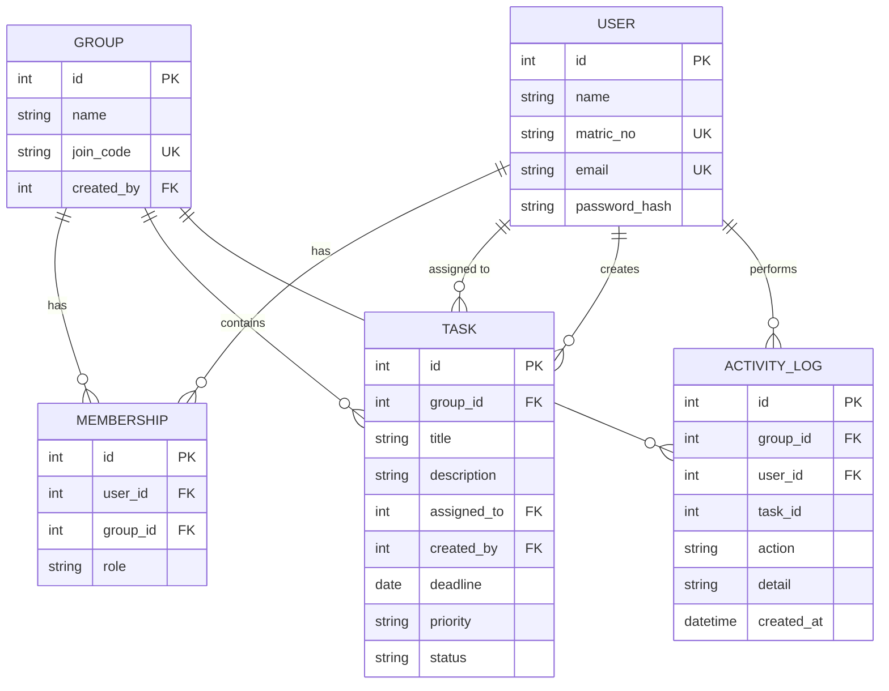
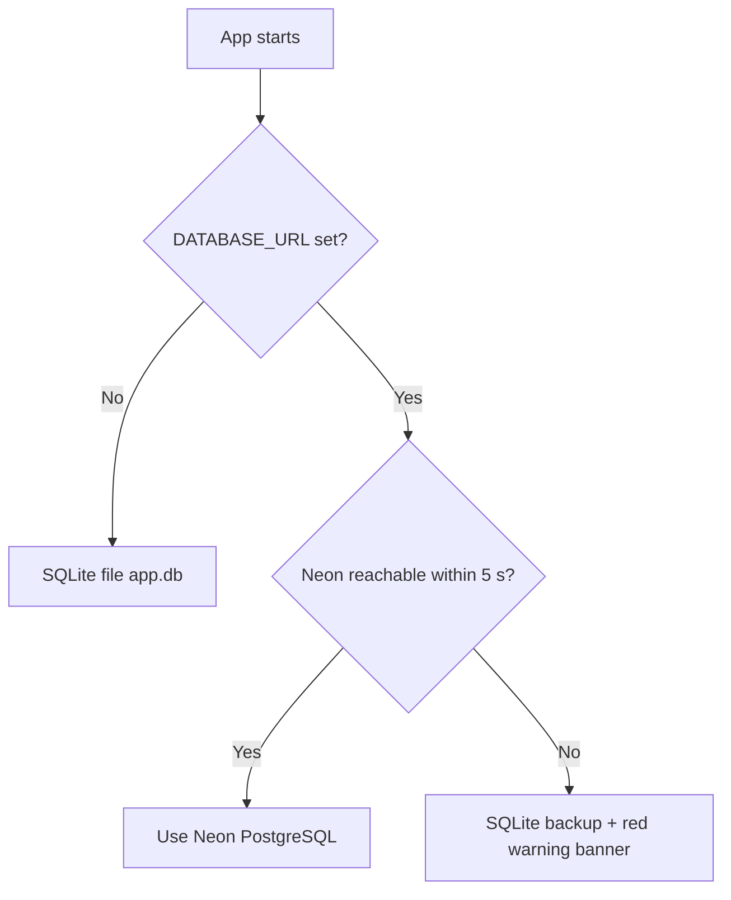
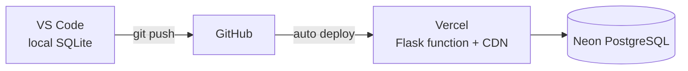
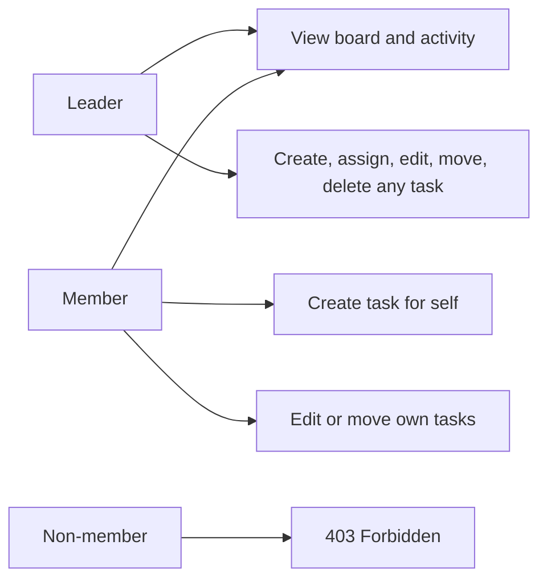
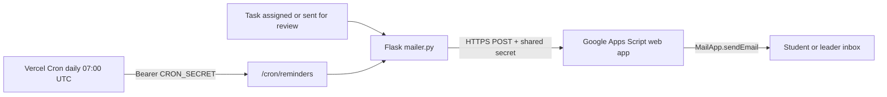

# CSC GRP 11: Group Project Task Board

A Kanban board where student groups assign tasks, set deadlines, and track progress.
Python Flask, SQLAlchemy, Tailwind CSS, SQLite (local) / PostgreSQL on Neon (hosted).
Process model: Incremental. Full design notes: [docs/ARCHITECTURE.md](docs/ARCHITECTURE.md).

## Features
- Welcome email on signup, forgot-password by email (single-use link, 1 hour), admin can email a reset link
- Admin-editable app name (default GroupFlow) and logo in header, landing page, favicon and emails
- Landing page for visitors (what Kanban is, how it works, sign up and log in buttons)
- Register and log in with matric number
- Create a group, join with a code, leader and member roles
- Kanban board (To do, In progress, In review, Done) with drag and drop and arrow buttons
- Task assignee, deadline, priority, overdue and due-soon highlighting
- Progress bar, task counts, "only my tasks" filter
- Activity log of every change (who, what, when)
- Responsive, dark-mode aware UI

## Architecture



## Project structure



## Move a task (request flow)



## Data model



## Database selection (automatic)



## Deployment pipeline



## Roles and permissions



## Email notifications (optional, free)



Setup: paste `docs/apps-script/Code.gs` into a new project at script.google.com, add the script property `SHARED_SECRET`, deploy as a Web app (Execute as: Me, Access: Anyone), then put the `/exec` URL and the same secret in your environment variables. Email is skipped when they are empty.

## Environment variables and secrets
Never commit keys. Locally copy `.env.example` to `.env` (git-ignored). On Vercel use Project Settings, Environment Variables.

| Name | Purpose |
|---|---|
| `APP_NAME` | Name shown in the app and landing page (default GroupFlow) |
| `SECRET_KEY` | Signs login sessions |
| `DATABASE_URL` | Neon connection string (empty locally = SQLite) |
| `APPS_SCRIPT_URL` | Apps Script Web app URL |
| `APPS_SCRIPT_SECRET` | Must equal the script's `SHARED_SECRET` |
| `CRON_SECRET` | Protects `/cron/reminders` |

## Super admin
Created only from the command line, never from the website, so nobody can promote themselves: `python create_admin.py`. Log in, then open `/admin`.
- Overview: users, groups, tasks, usage meters (users, emails today, database size), recent activity
- Users: search, suspend or reactivate, reset a password
- Groups: view any board read-only, delete a group
- Limits and email: registration on/off, max users, groups per user, members per group, tasks per group, daily write requests per user, daily emails, database storage cap, and a test-email button

Limits are enforced on the server. A cap of 0 means unlimited. Older databases are upgraded automatically on start.

## Run locally (Windows, Command Prompt, inside this folder)
```
python -m venv venv
venv\Scripts\activate
pip install -r requirements.txt
python seed.py          (optional demo data; login DEMO1 / Password123)
python run.py
```
Open http://127.0.0.1:5000. Run the tests with `python -m pytest -q`.

## Deploy on Vercel
1. Push to GitHub.
2. Create a free Postgres database at neon.tech and copy its connection string.
3. vercel.com, Add New, Project, import the repo.
4. Add environment variables `SECRET_KEY` (long random text) and `DATABASE_URL` (the connection string).
5. Deploy. Tables are created on the first request.

## Git rules
No commits to `main`. Work on a branch (`git checkout -b feature-name`), `git pull` first, small commits, open a pull request. `app.db` is ignored; each person creates their own.

## UI notes
Styling uses the Tailwind Play CDN (loaded in `app/templates/base.html`), so there is no build step. The page needs internet to load Tailwind. For heavy production use, compile CSS with the Tailwind CLI instead.
