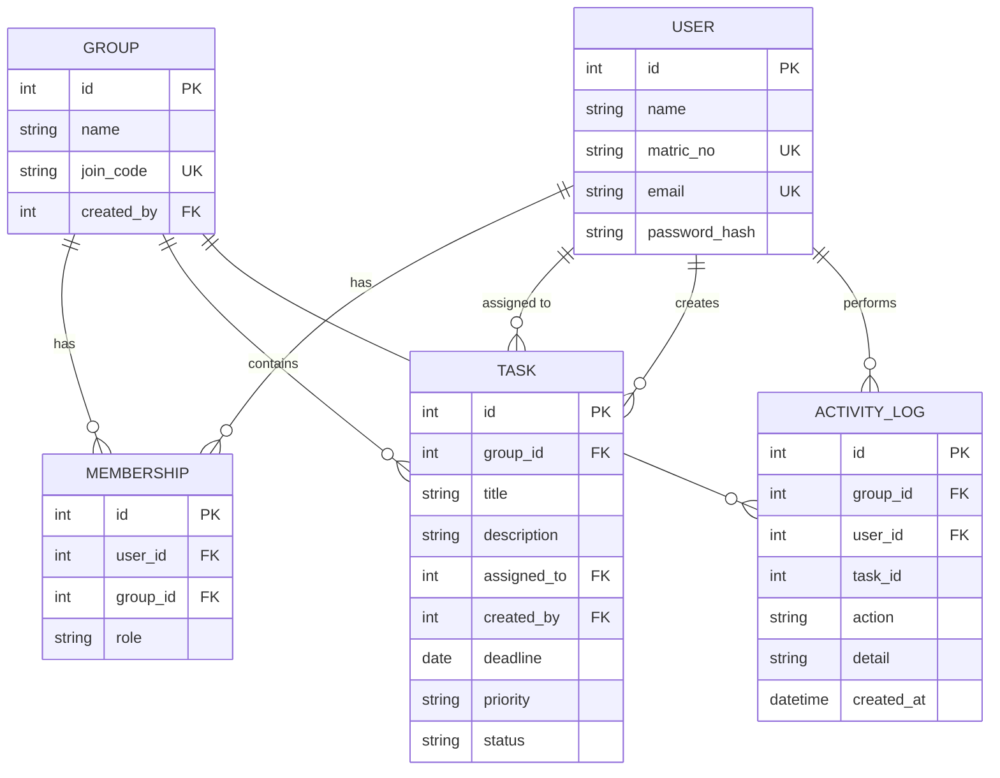

# Architecture and Design: CSC GRP 11 Task Board

Process model: Incremental. Stack: Python Flask, SQLite (SQLAlchemy), Jinja templates, vanilla JS.

## 1. Architecture (layered MVC, Flask blueprints)

```
Browser (HTML + CSS + board.js)
        |  HTTP / JSON (fetch, CSRF token)
Presentation   templates/*.html, static/
Controllers    auth/routes.py, groups/routes.py, tasks/routes.py   (blueprints)
Business rules utils.py (membership checks, activity log), validation in routes
Data access    models.py (SQLAlchemy ORM)
Storage        SQLite file app.db
```
Why: modular (one blueprint per feature), low coupling (routes depend on models, never on each other), high cohesion (each module has one job). The app factory (`create_app`) lets tests use an in-memory database.

## 2. Modules and increments

| Increment | Module | Files |
|---|---|---|
| 1 | Accounts | auth/routes.py, login.html, register.html |
| 1 | Groups | groups/routes.py, dashboard.html |
| 2 | Tasks + Kanban | tasks/routes.py, board.html, board.js |
| 3 | Deadlines, progress, activity log | Task.is_overdue, Group.progress, activity.html |

## 3. ERD


User and Group are many-to-many, resolved by MEMBERSHIP (carries the role). Unique constraint on (user_id, group_id).

## 4. Roles and permissions

| Action | Leader | Member | Non-member |
|---|---|---|---|
| View board and activity log | Yes | Yes | No (403) |
| Create task | Yes | Yes (config `ANY_MEMBER_CAN_CREATE`) | No |
| Assign task to others | Yes | No (self only) | No |
| Edit / move task | Any task | Own (assigned or created) | No |
| Delete task | Yes | No | No |

Set `ANY_MEMBER_CAN_CREATE` in `config.py` from the survey result.

## 5. Use cases (for the UI/UX and Design leads)
Register, Log in, Create group, Join group by code, Add task, Assign task, Edit task, Move task (drag or arrows), Delete task (leader), View progress, View activity log, Log out.

## 6. Key routes

| Method | Route | Purpose |
|---|---|---|
| GET/POST | /register, /login | Accounts |
| POST | /logout | End session |
| GET | /dashboard | My groups |
| POST | /groups/create, /groups/join | Group management |
| GET | /groups/<id>, /groups/<id>/activity | Board, history |
| POST | /groups/<id>/tasks | Create task |
| GET/POST | /tasks/<id>/edit | Edit task |
| POST (JSON) | /tasks/<id>/move | Change status |
| POST | /tasks/<id>/delete | Delete task |

## 7. Non-functional design decisions

| Requirement | How it is met |
|---|---|
| Security | Hashed passwords (werkzeug), CSRF tokens on all POSTs, ORM prevents SQL injection, Jinja auto-escaping prevents XSS, server-side role checks, open-redirect guard on login |
| Usability | Responsive CSS, arrow buttons as well as drag-and-drop (works on phones) |
| Maintainability | Blueprints, app factory, comments, tests |
| Accountability | Activity log of every change with user and time |
| Portability | SQLite file; switch DB by setting `DATABASE_URL` |

## 8. Known limitations (state these in the defense)
SQLite suits light concurrent use only; no email notifications yet (Increment 3 extension); no password reset; leader role cannot be transferred; times are stored in UTC.
